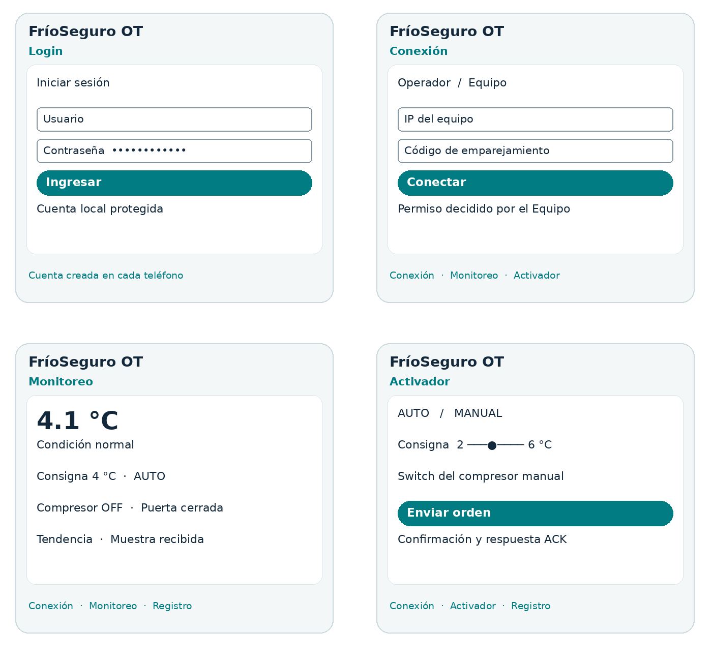
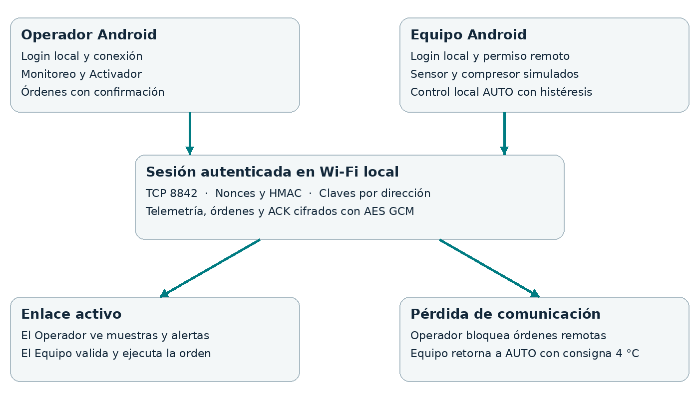

# Diseño de FríoSeguro OT

## Problema y objetivo

Un encargado que no está junto a una cámara de refrigeración carece de visibilidad inmediata sobre temperatura, puerta y estado del compresor. El prototipo comunica un equipo simulado con un operador para mostrar condiciones, detectar eventos y confirmar cambios de control.

La simulación se realiza en un segundo teléfono Android, como pide la guía; no se inventa una lectura de un sensor físico. El operador recibe valores producidos por el otro teléfono y envía órdenes que este valida y aplica. Los límites de 2 a 6 °C para la consigna y la alarma por encima de 8 °C o por debajo de 0 °C son parámetros didácticos.

## Herramientas y conectividad

Android Studio y Kotlin son las herramientas exigidas. AndroidX AppCompat, ViewModel, LiveData y componentes Material separan la vista de las tareas de red y mantienen estado ante recreación de Activity. El módulo core permite probar criptografía y simulación en la JVM. La conexión usa Socket y ServerSocket en hilos de trabajo; la UI no ejecuta recepción de red.

Se elige Wi-Fi local por su disponibilidad en ambos teléfonos, su alcance útil para una sala y la posibilidad de mostrar una red local sin Internet. Bluetooth sería útil a corta distancia, pero la guía permite elegir uno de los medios y no exige implementar ambos. No se realiza escaneo de redes, descubrimiento, conexión automática al Wi-Fi ni lectura de SSID; el usuario configura la red y copia la IP.

El manifiesto declara INTERNET, ACCESS_NETWORK_STATE y ACCESS_WIFI_STATE. Con target SDK 35, los sockets LAN no requieren pedir Bluetooth, GPS ni permisos de escaneo Wi-Fi. Al migrar a target SDK 37 se deberá revisar el nuevo permiso de red local, de acuerdo con la documentación Android. El proyecto no simula un permiso que no usa.

## Pantallas

1. **Login**: creación inicial y acceso local mediante usuario y contraseña; secretos ocultos y validación.
2. **Conexión**: rol Equipo u Operador, IP, código, permiso remoto y estado. El rol y el permiso se fijan antes de iniciar una ejecución.
3. **Monitoreo**: temperatura, consigna, modo, compresor, puerta, alarma, tendencia de 60 muestras y calidad del enlace. En el Equipo agrega escenarios de simulación.
4. **Activador**: radio buttons AUTO y MANUAL, slider de consigna, switch de compresor y botón con confirmación. Se bloquea sin datos actuales, conexión o permiso.
5. **Registro**: RTT, tráfico cifrado, muestras, órdenes, confirmaciones y exportación de eventos.

La navegación inferior presenta las cuatro pantallas tras el login. Se usan textos y estados junto con el color; las alertas no se comunican únicamente mediante color. Los campos tienen etiquetas, botones accesibles, controles de 48 dp y contenedores desplazables. El teclado no cubre los campos de conexión. Las vistas sensibles inhiben capturas; para acreditar el login se puede tomar una foto externa sin mostrar secretos.

## Arquitectura y datos

El Equipo produce una muestra por segundo y mantiene el control AUTO local. El Operador envía un ping cada segundo para medir RTT, recibe telemetría y envía una orden a la vez. El Equipo responde con ACK y el estado aplicado o una causa de rechazo. La recepción expira a los 7 segundos sin mensajes. Después de una pérdida de sesión, se requiere reconexión del Operador; solo los intentos iniciales de conexión tienen reintentos acotados.

Tipos de mensajes dentro del canal cifrado: telemetry, command, ack, ping y pong. Las órdenes incluyen UUID y timestamp; se validan el permiso, la vigencia de 60 segundos, duplicados recientes, frecuencia máxima de cinco órdenes por segundo, modo y valores finitos dentro del rango. La app limita a una orden pendiente y deja de esperarla tras 4 segundos sin ACK; no asume que una orden sin ACK no se aplicó.

El Equipo usa histéresis de 0.5 °C: enciende el compresor por encima de consigna más 0.5 y lo apaga por debajo de consigna menos 0.5. En MANUAL se conserva la orden explícita. Al perder la sesión vuelve a AUTO con consigna 4 °C. Cada dirección cifrada usa su contador y sus claves.

## Validación del docente

Presentar problemática, roles, elección de Wi-Fi, bosquejos y límites. Solicitar al docente que confirme la pertinencia para TI3042 Unidad 2 y registre las observaciones. Las reuniones y la aprobación no se presuponen. Si ya existe un tema de Unidad 1, el docente debe confirmar que este tema nuevo sea compatible con la continuidad de la asignatura.
