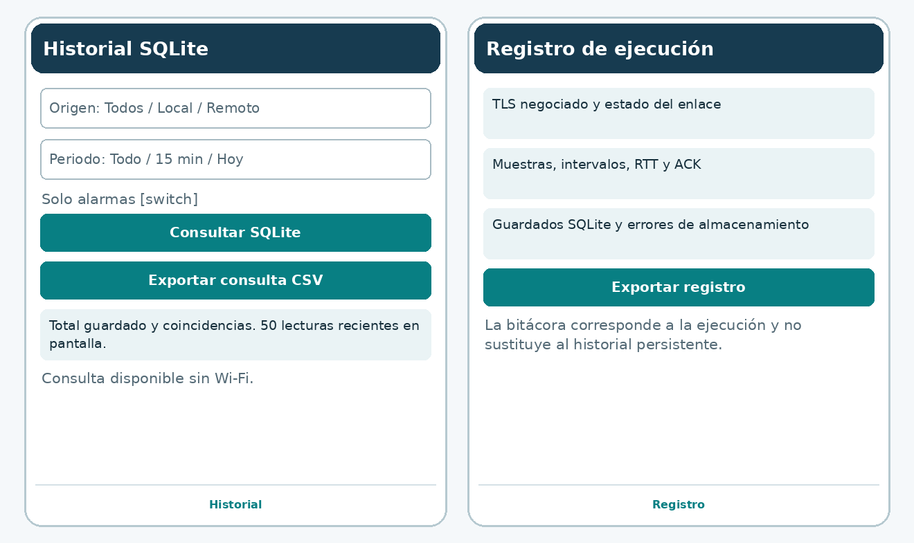

# Diseño de FríoSeguro OT para la evaluación sumativa

## Problema y objetivo

El encargado de una cámara de refrigeración puede carecer de visibilidad sobre temperatura, puerta y compresor al encontrarse en otra zona. El proyecto conecta un Equipo simulado con un Operador Android para observar condiciones, alertar, confirmar cambios de control y consultar después las lecturas guardadas.

Los sensores y el actuador se simulan en el teléfono B; el teléfono A recibe sus datos. Los límites de consigna de 2 a 6 °C y las alarmas por encima de 8 °C, por debajo de 0 °C o por puerta abierta son didácticos. El sistema no se conecta a un refrigerador o PLC real.

## Herramientas

Android Studio y Kotlin son los exigidos por la guía. AppCompat y componentes Material construyen vistas nativas; ViewModel/LiveData separan la UI del estado; los ejecutores atienden red, cifrado, autenticación y consultas. SQLiteOpenHelper proporciona almacenamiento relacional local. SSLSocket y SSLServerSocket habilitan TLS y Android Keystore protege claves AES y la identidad RSA del Equipo.

La combinación de Kotlin 2.1.10, AGP 8.9.2, Gradle 8.11.1, JDK 17 y SDK 35 está fijada. Se usa SQLite directamente por el tamaño acotado del esquema y para hacer visible el SQL de la actividad. Android recomienda Room como abstracción para modelos más amplios. Las consultas actuales usan parámetros y pruebas explícitas. Ver `DATOS_SQLITE.md` para la comparación con Firebase y API/MySQL, el esquema y el contrato interoperable.

## Elección de Wi-Fi

| Aspecto | Decisión y efecto |
| --- | --- |
| Distancia | Wi-Fi permite la demostración dentro de una sala y el ensayo con una pared; el alcance real depende del router y debe medirse |
| Energía | Dos apps en primer plano con una muestra y un ping por segundo consumen más que un sensor BLE dormido; es una elección didáctica para teléfonos, no una promesa de autonomía |
| Estabilidad | TCP entrega en orden y retransmite; TLS autentica y cifra; la app detecta datos vencidos, limita colas y exige reconexión después de una pérdida |
| Infraestructura | Red local sin Internet, con router o hotspot de un tercer teléfono y sin aislamiento de clientes |

Bluetooth resulta apropiado para dispositivos cercanos de bajo consumo; MQTT es un protocolo de mensajería que requiere definir un broker y un transporte. Para este prototipo se selecciona Wi-Fi con TLS sobre TCP, sin un servicio externo que condicione la demostración.

El usuario configura la Wi-Fi y copia una IPv4 privada. El manifiesto declara INTERNET y acceso al estado de red/Wi-Fi; no hay escaneo de redes ni lectura de ubicación. Las restricciones de red local deben revisarse si se cambia el target SDK fijado.

## Pantallas y navegación

1. Login: creación inicial y validación de credenciales SQLite, con secretos ocultos y bloqueo por intentos.
2. Conexión: Equipo u Operador, IP, código FS2, permiso remoto y estado TLS. La identidad se prepara fuera de la UI.
3. Monitoreo: temperatura, puerta, compresor, alarma, consigna, tendencia y métricas. El Equipo permite provocar escenarios.
4. Activador: AUTO/MANUAL, slider, switch y confirmación; bloqueado sin enlace reciente o permiso.
5. Registro: métricas, errores de persistencia y exportación de eventos de la ejecución.
6. Historial: filtros SQLite de origen, periodo y alarma, consulta sin conexión y exportación CSV.

Después del login, cinco destinos se muestran en la navegación inferior. Hay etiquetas, controles de 48 dp, contenedores desplazables y estados expresados con texto y color. Login y Conexión inhiben capturas de secretos. Las evidencias de vistas Android no deben confundirse con fotografías de dos teléfonos.

## Comunicación, datos y control

El Equipo abre TLS en el puerto 8842 y comparte un código FS2 con PSK de 128 bits y huella SHA256 de su certificado. El Operador valida exactamente esa identidad y la vigencia del certificado antes de autenticar la PSK. Se permiten TLS 1.2 o 1.3 y suites AEAD con intercambio efímero. No existe una ruta de conexión sin TLS. Las cuentas locales no se transmiten.

El Equipo captura y guarda cada segundo. El Operador recibe y guarda telemetría con `schemaVersion=2` y fecha de captura; envía un ping por segundo para RTT. El modelo marca datos vencidos tras 3 s; la lectura del socket expira a 7 s. Los intentos iniciales tienen reintentos acotados; una sesión perdida requiere reconexión manual.

Las órdenes incluyen UUID y timestamp. El Equipo verifica permiso, vigencia de 60 s, duplicados, frecuencia, modo y valores finitos. La UI admite una orden pendiente y espera ACK durante 4 s. No la reenvía automáticamente porque una orden sin confirmación podría haberse aplicado.

AUTO usa histéresis de 0.5 °C. Al perder el enlace, el Equipo retorna a AUTO con consigna 4 °C mientras siga iniciado en primer plano. Cerrar la app detiene la simulación; no hay controlador físico que continúe fuera del proceso Android.

## Validación docente

Presentar problemática, continuidad con Unidad 1, elección de Wi-Fi, bosquejos, autenticación SQLite, esquema y medidas de seguridad. Registrar las observaciones reales del docente. La aprobación del diseño y la demostración presencial no se presuponen.
